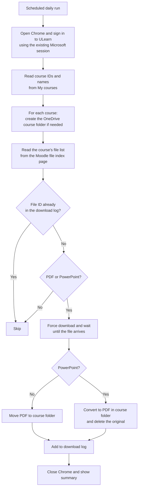

# ULearn Sync

**Automated Lecture Material Downloader built with Microsoft Power Automate Desktop**

ULearn Sync is a personal Robotic Process Automation (RPA) project that checks every course on UTP's ULearn learning platform, downloads newly uploaded lecture materials and saves them as PDFs into OneDrive folders organised by course. PowerPoint slides are converted to PDF automatically. The flow runs once a day on its own and only downloads files it has not seen before.

---

## The Problem

Checking each ULearn course page every week for new materials is slow and easy to forget. Lecturers upload at different times and do not always announce it, so new files are easy to miss. Downloaded files also pile up in one Downloads folder with mixed formats, which makes revision harder.

## What It Does

* Signs in to ULearn using the existing Microsoft session (no password stored)
* Reads the list of enrolled courses automatically
* Finds every file in each course
* Downloads only **PDF** and **PowerPoint** files and skips images, Word and Excel files
* Converts **PowerPoint slides to PDF** using the PowerPoint app, then removes the original
* Saves each file into its own **course folder in OneDrive**, so everything is backed up
* Keeps a **download log** so files are never downloaded twice
* Shows a **summary** at the end, such as "2 new files downloaded", with the file names
* Runs **once a day automatically** through Windows Task Scheduler

## How It Works

### Flow sections

| Section | What it does |
|---|---|
| 1. Setup | Sets folder paths, loads the download log (or creates it on the first run) |
| 2. Log in to ULearn | Opens Chrome, clicks through Microsoft sign-in only when needed and waits for the dashboard |
| 3. Get course list | Uses a short JavaScript function to read each course's ID and name, and cleans names so they work as Windows folder names |
| 4. Download and organise files | Loops through every course and file, skips known files, downloads new ones, converts slides and logs results |
| 5. Summary | Closes the browser and shows how many new files were downloaded |

## Tools Used

| Tool | Purpose |
|---|---|
| Microsoft Power Automate Desktop | Builds and runs the RPA flow |
| Google Chrome + Power Automate extension | Browser controlled by the flow |
| JavaScript | Reads course and file lists, finds real file addresses and starts downloads |
| PowerShell + PowerPoint (COM automation) | Converts PowerPoint slides to PDF |
| OneDrive | Stores and backs up the course folders |
| Windows Task Scheduler | Runs the flow once a day |
| CSV log file | Records every downloaded file |

## Key Design Decisions

**Using Moodle's file index page.** ULearn is built on Moodle. Each course has a hidden page (`mod/resource/index.php?id=COURSE_ID`) that lists all files in one simple table. Reading this page is much more reliable than reading each course page, where every lecturer arranges sections differently.

**Logging by file ID instead of file name.** Every ULearn file has a fixed ID. Lecturers sometimes rename files, but the ID stays the same, so using it in the log prevents duplicate downloads.

**Checking the file type before downloading.** A lightweight request asks ULearn for the real file address without downloading the file. The flow reads the file extension from that address and only downloads PDFs and PowerPoints. This avoids unnecessary downloads and keeps load on the server low.

**Forcing downloads.** Moodle's `forcedownload=1` option makes every file download instead of opening in the browser. This solved an early problem where images and PDFs opened in a tab instead of being saved.

**Waiting for real completion.** Instead of a fixed wait, the flow checks every second (for up to 60 seconds) until the file has fully arrived, so large files are handled properly.

**Confirming conversion by checking the output.** The PowerPoint original is deleted only after the conversion script confirms success, so no file is ever lost.

## Screenshots

| OneDrive course folders | Inside a course folder |
|---|---|
|  |  |

| Summary message | Download log |
|---|---|
|  |  |

## Security and Responsible Use

| Area | Approach |
|---|---|
| No stored password | The flow never types or stores a password. It reuses the Microsoft session already signed in on the computer. |
| No security bypass | If Microsoft asks for a password or phone approval, the flow pauses and the user completes it. |
| Own account only | The flow only opens courses the user is enrolled in, exactly as they would by hand. |
| Server friendly | It runs once a day and checks file types with lightweight requests before downloading. |
| Respect for content | Downloaded materials are for personal study only. No lecture files, logs or account details are shared in this repository. |

## Testing

| Test | Result |
|---|---|
| Run while already signed in | Goes straight to the dashboard |
| Run after signing out | Clicks through Microsoft sign-in and reaches the dashboard |
| First full run | All PDFs and converted slides saved in the correct course folders |
| Run again with no new files | Nothing downloaded, summary shows 0 new files |
| Remove one file and its log entry, then run | Only that file is downloaded again |
| Course with images, Word and Excel files | Those files are skipped |
| Scheduled run | Starts automatically through Task Scheduler |
| OneDrive sync | Files appear on OneDrive web and mobile |

## Limitations

* Power Automate Desktop only runs on Windows, and the computer must be on and unlocked for the scheduled run.
* Files placed inside Moodle **Folder** activities are not included yet.
* If a lecturer replaces a file but keeps the same ULearn item, the new version is not downloaded again because the file ID is unchanged.

## Future Improvements

* Support files inside Moodle Folder activities
* Send a Microsoft Teams or email notification after each run
* Rename files automatically with the course code and week number
* Detect updated versions of existing files
* Connect a Copilot Studio chatbot to the saved PDFs for revision questions
* Build a Python and Playwright version that runs on macOS

## Author

**Adrianna Sofea Syuhada**
Bachelor of Computer Science (Hons), Data Analytics, Universiti Teknologi PETRONAS
GitHub: [AdriannaSofea](https://github.com/AdriannaSofea)
